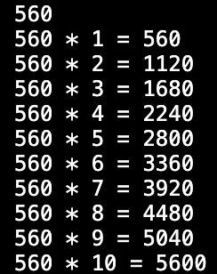
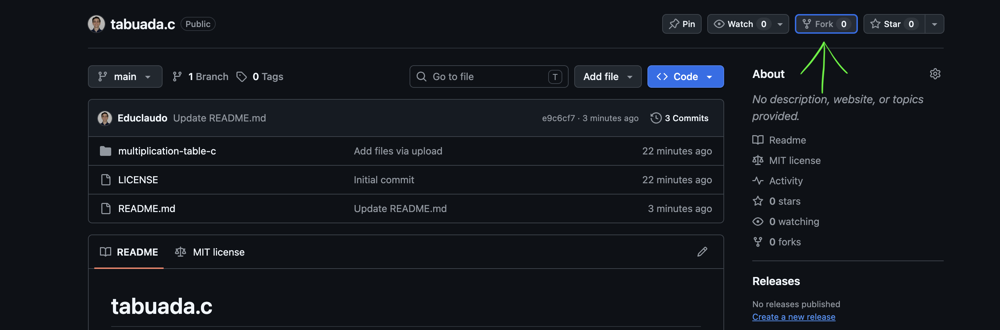
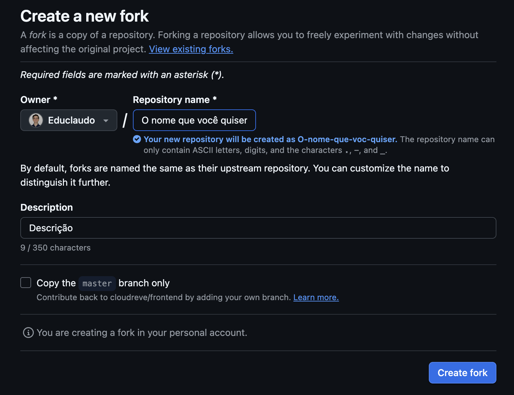
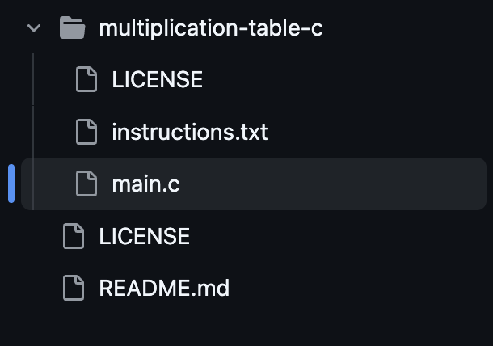
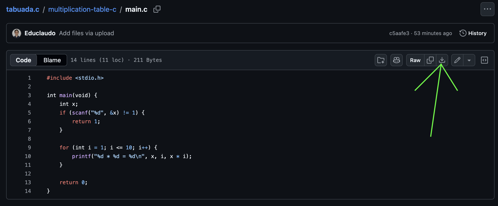

# tabuada.c

## Sobre o Código:

Esse código funciona com uma simples tabuada onde o usuário insere um número de 1 a 1000, e então é entregue a ele a tabuada daquele número, de 1 a 10. É ótimo para verificar a tabuada de um número rapidamente ou brincar de indentificar padrões.

Funciona de uma maneira simples, o usuário da run no código e insere um número, e dá play, como mostrado na imagem:

O código lê o número inserido pelo usuário e verifica se está entre 1 e 1000, por meio de um if, se estiver adequado o código prossegue normalmente (return 0) se não ele retorna 1 e para. Para printar a tabuada o código usa um loop for para multiplicar o número do usuário por i, que aumenta até chegar em dez e printa algo como: n * i = r. Sendo n o número inserido pelo usuário, i é o número da múltiplicação (1 a 10) e r o respectivo resultado. Simples.

## Como rodar o código? Onde? Intruções aqui:

Para rodar o código, é simples, pode ser copiado e colado em qualquer plataforma para rodar o código, como vscode, mycompiler e onlineGDB.

Para baixar o arquivo basta apenas usar a função "fork" do próprio github, como indicado pela seta verde na imagem abaixo:

Ao dar o fork, você será direcionado ao seu github e devera escolher o nome do seu arquivo clonado, como mostrando na seguinte imagem:

Uma vez feito isto, basta clicar no arquivo main.c

Lá você pode copiar e colar o código num compiler de internet como o onlineGDB ou o Visual Studio Code, ou então baixar o arquivo no botão indicado pela seta verde na imagem:

### Se for rodar no VSCode

PS: Lembrando, o código pode ser rodado em qualquer compiler de C, mas vou ensinar o caminho do VSC

*Primeiro, você deve ter baixado o VSC na sua máquina.*

Assim que você baixar o código main.c, ele aparecerá na sua janela de downloads, mais ou menos assim:

Se você clicar no arquivo main.c, você será diretamente direcionado ao aplicativo do VSC.

Abra o terminal.

No terminal crie um arquivo.c, pode ter o nome que desejar:

        $ code main.c

Para rodar tem que fazer o make do arquivo e então dar ./, o ./ dá run no código, e o make deixa ele rodável:

        $ make main
        $ ./main

E então o código vai rodar. ;)

## Testando o código

Para testar, ao rodar o código seja lá qual for o compiler escolhido, teste o código usando o número que preferir.

Insira 45:

    45

Dê enter, e o resultado esperado é o seguinte:

    45 * 1 = 45
    45 * 2 = 90
    45 * 3 = 135
    45 * 4 = 180
    45 * 5 = 225
    45 * 6 = 270
    45 * 7 = 315
    45 * 8 = 360
    45 * 9 = 405
    45 * 10 = 450

## Sobre a License

** A LICENSE escolhida para este arquivo é a licensa do MIT, que te dá muita liberdade para clonar e mecher no arquivo clonado como bem entender. Seja feliz.

O texto oficial sobre a licensa está aqui: https://opensource.org/license/mit e https://mit-license.org/

**Este repositório é protegido pela <a href="./LICENSE">MIT License</a>**
